<p align="center">
  
</p>

<h1 align="center">ShotoPhopEX</h1>

<p align="center">
  <b>The layered image editor with a generative AI studio inside it.</b><br>
  Fill, Expand, Remove, Edit, Split into Layers and text to image, on open-weight models,<br>
  running on your own GPU. Written in Rust. No cloud, no account, no credits, no Python, no ComfyUI.
</p>

<p align="center">
  
  
  
  
  
  
  
  <a href="https://github.com/CodyChuGit/ShotoPhopEX/stargazers"></a>
</p>

<p align="center">
  <a href="#-at-a-glance">At a glance</a> ·
  <a href="#-features">Features</a> ·
  <a href="#-benchmarks">Benchmarks</a> ·
  <a href="#-will-it-run-on-my-card">Your GPU</a> ·
  <a href="#-install">Install</a> ·
  <a href="#-install-with-an-agent">Agent install</a> ·
  <a href="#-models">Models</a> ·
  <a href="#-faq">FAQ</a>
</p>

<br>

<p align="center">
  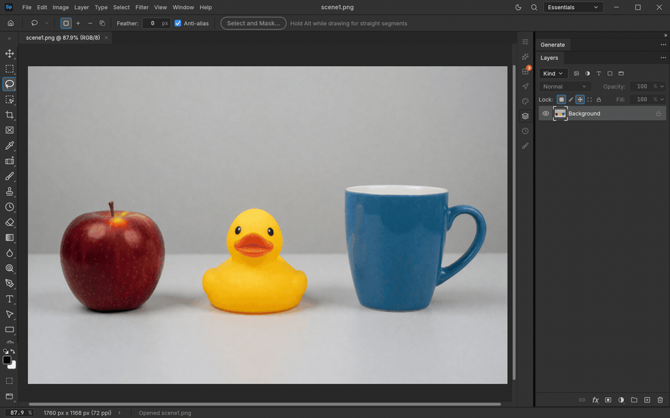
  <br>
  <sub><b>Split into Layers</b>: one click turns this café photo into a stack of cut-out layers (people, tables, chairs, a bicycle, a dog) over a repainted background, shown here hidden one by one. Recorded in the app on an RTX 5090; the 3-minute wait is sped up.</sub>
</p>

<br>

## ⚡ At a glance

ShotoPhopEX is a full layered photo editor (layers, masks, adjustment layers, type, vectors,
brushes, real PSD files) with Photoshop-style generative tools built in. Every model runs on your
own NVIDIA card through a native Rust engine with its own CUDA kernels, and every result lands on
its own masked layer, so the original pixels never change.

| | |
|---|---|
| **What you get** | Generative Fill, Edit, Remove, Expand, Angles, Upscale, Split into Layers, Clown Pass, Select by text and text to image |
| **Where it runs** | On your own NVIDIA RTX card, from 12 GB of VRAM, on Windows 10 or 11 |
| **What it doesn't need** | No cloud, no account, no credits, no Python, no ComfyUI |
| **Speed** | Matches or beats ComfyUI on the same GPU: a picture in 3 s, Upscale 2× in 24 s against ComfyUI's 44 s ([benchmarks](#-benchmarks)) |
| **Models** | Open weights you bring yourself (Krea 2, Qwen-Image-2.1, MOSS, SAM 3.1), in ComfyUI's folder layout |
| **Status** | Alpha. Built from source today; no release yet ([install](#-install)) |
| **Licence** | MIT or Apache-2.0. Each model keeps its own licence |

- 🎨 **The tools artists use.** Start from a selection and a prompt; the app picks the model.
- ⚡ **Fast.** Our own int8 kernels, resident encoders and merged LoRAs.
- 🔒 **Local and private.** One executable plus NVIDIA's libraries. Nothing leaves your PC.
- 🤖 **Agent-ready.** Every action is a command, so the UI, the CLI and an MCP server drive the same 500+ commands.

## ✨ Features

Every clip was recorded in the real app on one RTX 5090, at real speed unless it says otherwise.
The photos were generated in the app too, so no stock images are involved. Times are warm.

### Generative Fill

<p align="center">
  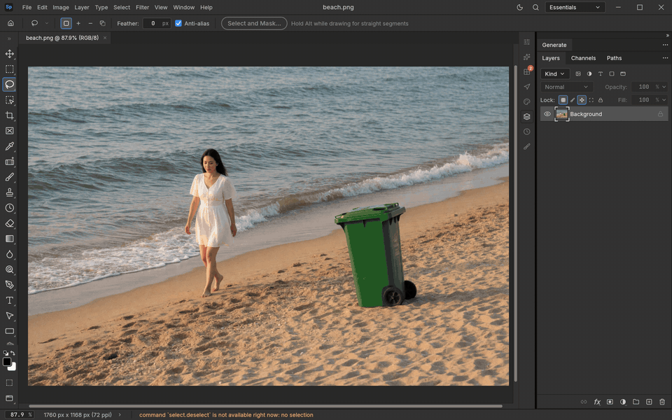
</p>

Lasso some empty sand, ask for a parasol and a lounger, and Krea 2 AnyPaint paints them in at the right scale and light. **6.6&nbsp;s.**

### Generative Edit

<p align="center">
  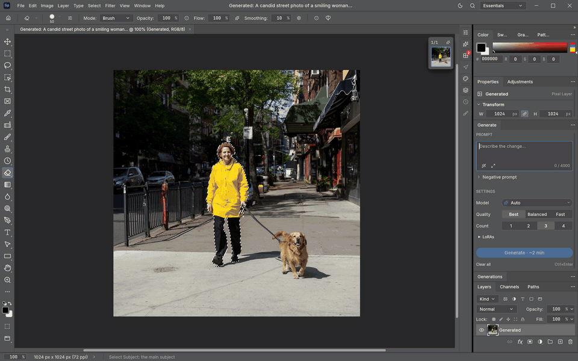
</p>

Type what should change inside the selection ("make the jacket red") and watch the live preview sharpen. Three variations, each on its own masked layer. **5.1&nbsp;s.**

### Clothing edits

<p align="center">
  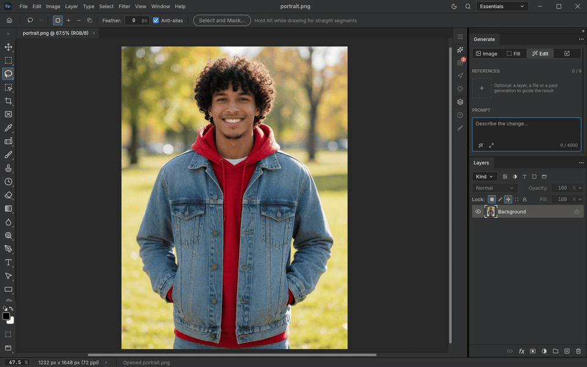
</p>

Select by text "denim jacket", ask for black leather, and only the jacket changes: face, hoodie and background stay put. **7&nbsp;s.**

### Generative Remove

<p align="center">
  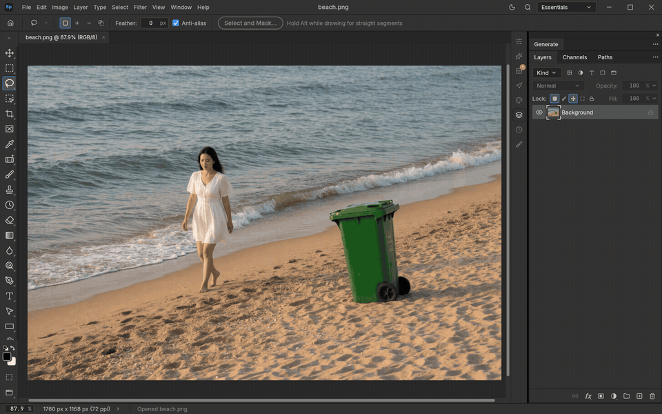
</p>

Right-click a rough selection and choose Generative Remove. The bin is gone and the beach carries on behind it. **10&nbsp;s.**

### Generative Expand

<p align="center">
  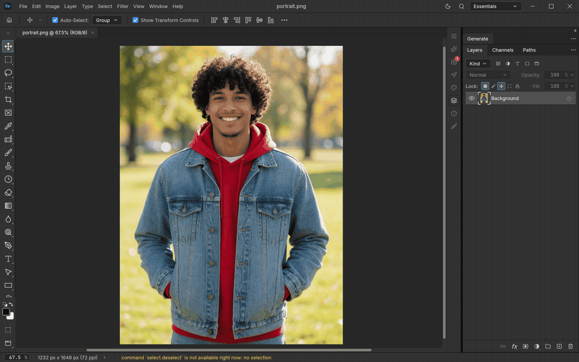
</p>

Grow the canvas and the scene continues, people included, with an outpainting LoRA that keeps the original pixels in place. A 2 MP portrait grown to 3.6 MP in **32&nbsp;s.**

### Generative Angles

<p align="center">
  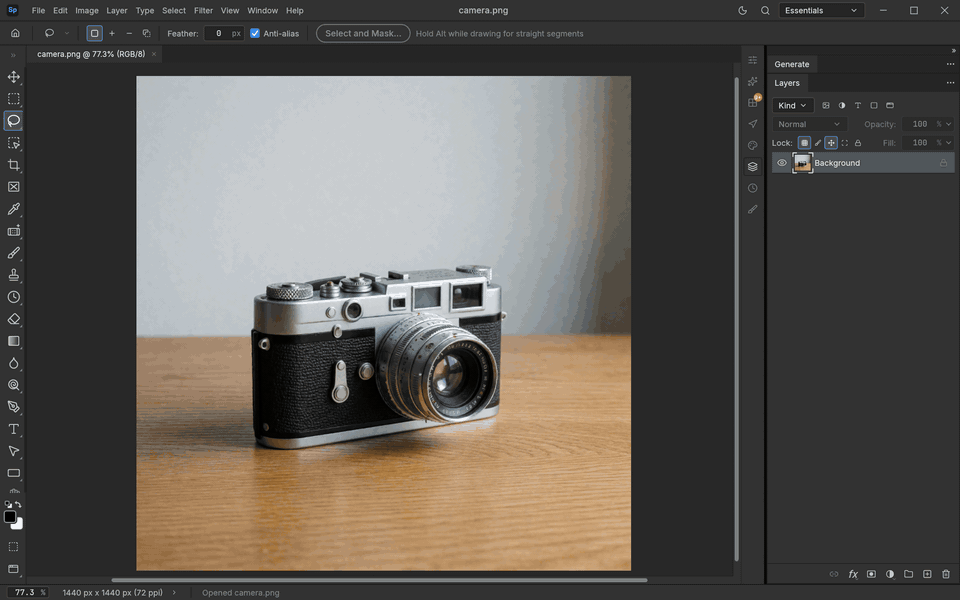
</p>

Move the camera after the shot: a back view, a high angle, a close-up. **About 7&nbsp;s each.**

### Text to image with MOSS Turbo

<p align="center">
  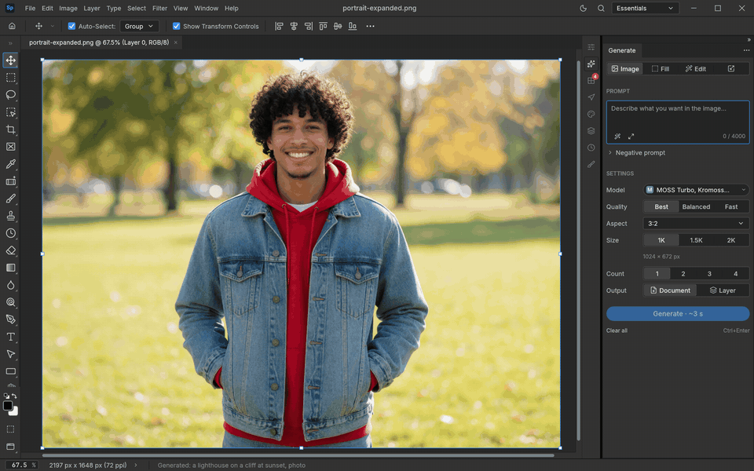
</p>

The low-VRAM option: an 8-step Apache-2.0 model that fits a 12 GB card and spells its lettering right. **1.6&nbsp;s** on a 5090.

### Object Selection

<p align="center">
  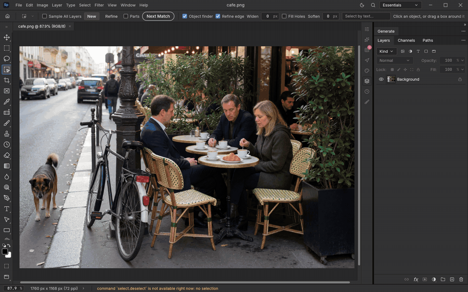
</p>

Hover, and what a click would take lights up in its own colour once the pointer rests. Turn on **Parts** to pick a head or the hair instead of the whole person. **0.45&nbsp;s.**

### Select Subject

<p align="center">
  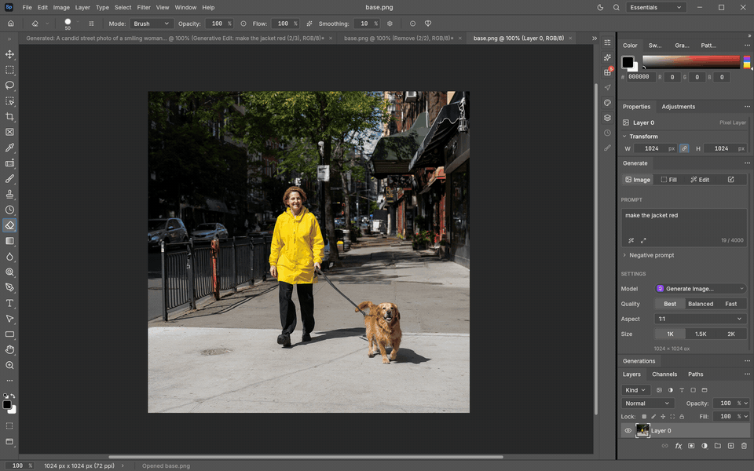
</p>

One click and SAM 3.1 finds the subject. **0.6&nbsp;s** warm, 2.2 s cold.

### Clown Pass

<p align="center">
  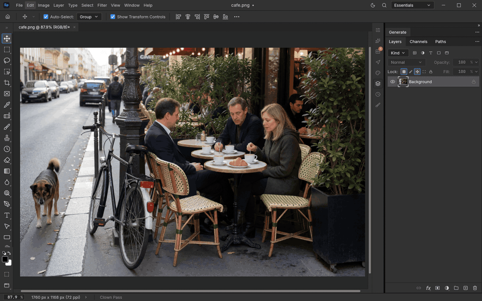
</p>

Every person and thing in the picture on its own colour-coded, edge-matted layer: the ID pass compositors know. 40 layers from a busy café in **about 10&nbsp;s.**

### Image Quality

<p align="center">
  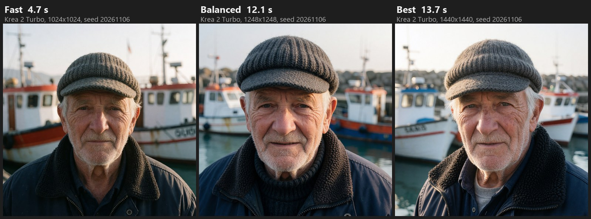
</p>

One switch trades seconds for detail: **Fast**, **Balanced** or **Best**, up to Krea 2 at about 2 MP (1440²). Same prompt and seed in all three.

### Every feature

| Feature | What it does | Default model | Warm time, RTX 5090 |
|---|---|---|---|
| **Generate Image** | Text to image into a new layer or document, with optional reference pictures, at Fast, Balanced or Best | Krea 2 Turbo (Qwen-Image-2.1, MOSS selectable) | **3.0 s** Fast · 5.4 s Balanced · 9.2 s Best |
| **MOSS Turbo** | The low-VRAM text to image: Kromoss with an 8-step DMD2 LoRA, Apache-2.0, strong lettering | Kromoss + DMD2 LoRA | **1.6 s** (1024×672) |
| **Image from a reference** | A new picture steered by up to ten references | Qwen-Image-2.1 | **5.2 s** |
| **Generative Fill** | Repaint the selection from a prompt, on a masked layer, with variations | Qwen-Image-2.1 (Krea 2 AnyPaint selectable) | **3.2 s** · 6.6 s AnyPaint at 0.6 MP |
| **Fill from a reference** | Repaint the selection with what a reference picture shows | Qwen-Image-2.1 edit | 9.6 s |
| **Remove · Generative Remove** | One stroke or a selection: the object is found, named and removed with its shadow; the best of two tries is kept | Qwen-Image-2.1 edit + SAM 3.1 | **4.3 s** (10.2 s from a lasso) |
| **Generative Edit** | Change what is in the picture by instruction ("make the jacket leather") | Qwen-Image-2.1 (MOSS Edit Turbo on small cards) | **5.1 s** (7.1 s with a text selection) · 3.8 s MOSS Edit Turbo |
| **Generative Expand** | Grow the canvas and continue the scene, people included | Qwen-Image-2.1 + Outpaint LoRA | about 10 s at 1 MP · 32 s to 3.6 MP |
| **Split into Layers** | Every subject on its own matted layer, nearest on top, over a repainted background; Rough, Medium or Fine detail | SAM 3.1 + ViTMatte + fill | 4.2 s for one subject · 3–3.5 min for a busy 2 MP scene |
| **Clown Pass** | Everything in the picture on its own colour-coded, edge-matted layer, no fills | SAM 3.1 + ViTMatte | **9.5 s** (40 layers, 2 MP) |
| **Remove Background** | A soft alpha matte around the subject, as a layer mask | SAM 3.1 + ViTMatte | **0.45 s** |
| **Select Subject / by text / by point** | Open-vocabulary selection: "the red car", "eye:2", a click, or a part of an object | SAM 3.1 | **0.3 s** |
| **Generative Angles** | Orbit a camera around the subject (8 directions, 4 heights, 3 distances) | Qwen-Image-2.1 edit (2511 Angles LoRA selectable) | 7.2 s |
| **Generative Upscale 2×** | Enlarge with new detail on a few large tiles, staying true to the original | Qwen-Image-2.1 edit + Restore LoRA | **24.2 s** |
| **Prompt Enhance** | Rewrites a short prompt into a full one, reading the picture | Qwen3-VL | ~1–2 s |

Times are warm, measured in the app at about 1 MP unless the row says otherwise (2026-10-28 to 2026-11-06). **Bold** means faster than ComfyUI on the
same GPU or a feature ComfyUI has no matching graph for. Every feature also takes **LoRAs** from
your models folder, and Qwen-Image-Edit-2511 with its Lightning LoRAs is selectable for Fill, Edit,
Remove and Expand.

<details>
<summary><b>How it feels in the app</b></summary>

- **Window › Generate** is the panel in the dock: a switch for Image, Fill, Edit or Expand, then
  References (drop pictures on it), Prompt and Settings (model, quality, size, count), and one
  **Generate** button (Ctrl+Enter). Auto names the model it will use.
- **Image Quality** is one switch: Fast (the default), Balanced, or Best (Krea 2 at about 2 MP,
  Qwen-Image-2.1 at 40 steps with CFG 3).
- **Live preview** paints the picture on the canvas as it forms, at no measurable cost.
- **Under any selection**, a task bar offers Fill or Edit right where you are working, and the
  right-click menu has Generative Fill and Generative Remove.
- **The Object Selection tool (W)** waits until the pointer settles, tints what a click would
  take in a colour of its own per object, and with **Parts** picks a piece (a head, the hair).
- **Layer › Split into Layers** asks only one thing: Rough, Medium or Fine.
- **The Variations strip** keeps the last runs as tiles: keep one, drop one, or ask for more.
- **Window › Generations** is the library of every run, with Recreate, Place, Save and Copy prompt.
- **The engine dot** in the status bar shows the worker's state, with Start, Stop, Purge models
  and Show log.

</details>

## 📊 Benchmarks

<p align="center">
  <picture>
    <source media="(prefers-color-scheme: dark)" srcset="docs/images/genai/bench-5090-dark.svg">
    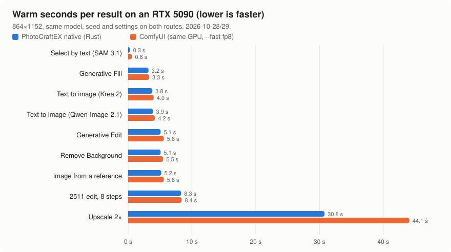
  </picture>
</p>

Same model, same seed, same settings and the same picture on both routes, one route on the GPU at
a time. "Warm" is the second request with a new seed (a repeated request would hit ComfyUI's
cache). ComfyUI ran with `--fast fp8_matrix_mult`.

| Feature (864×1152, warm) | ShotoPhopEX | ComfyUI | Speed-up |
|---|---:|---:|---:|
| Select by text (SAM 3.1) | **0.3 s** | 0.6 s | 2.0× |
| Generative Fill (Qwen-Image-2.1) | **3.2 s** | 3.3 s | 1.03× |
| Text to image (Krea 2 Turbo, 8 steps) | **3.8 s** | 4.0 s | 1.05× |
| Text to image (Qwen-Image-2.1, 25 steps) | **3.9 s** | 4.2 s | 1.08× |
| Generative Edit (Qwen-Image-2.1) | **5.1 s** | 5.6 s | 1.10× |
| Remove Background (2.1 matte) | **5.1 s** | 5.5 s | 1.08× |
| Image from a reference (Qwen-Image-2.1) | **5.2 s** | 5.6 s | 1.08× |
| 2511 Angles (4 steps) | **4.4 s** | 4.5 s | 1.02× |
| 2511 edit (Lightning, 8 steps) | **7.25 s** | 8.4 s | 1.16× |
| 2511 full-quality edit (40 steps, CFG 4) | 86.8 s | 81.9 s | 0.94× |
| Generative Upscale 2× | **24.2 s** | 44.1 s | 1.82× |
| MOSS-Image (1024², 50 steps) | 11.0 s | 10.8 s | 0.98× |

Measured on an RTX 5090 (32 GB, Windows 11) on 2026-10-28 and 29. Remove Background has since
moved to SAM 3.1 + ViTMatte (0.45 s). Split into Layers, Clown Pass and the MOSS Turbo routes have
no ComfyUI graph to compare against, so they are listed in [Every feature](#every-feature) only. No RTX
3090 numbers exist yet, so none are shown. Every run, its script and the raw reading are in
[`docs/comfy/benchmarks.md`](docs/comfy/benchmarks.md).

<details>
<summary><b>What makes it fast</b></summary>

Qwen-Image-2.1 runs as an int8 ConvRot DiT built once from the bf16 weights and cached, through
our own kernels and a flash-attention path. The text encoder stays resident between requests,
the conditioning is cached when only the seed changes, and LoRAs are merged into the resident
int8 weights once instead of costing a side path every step. Qwen-Image-Edit-2511 runs
SageAttention2 (INT8 attention) on every block where it holds the picture, and Upscale works on
fewer, larger tiles. MOSS Edit caches its reference keys and values once per edit. Outputs were
checked against the ComfyUI route at every step (within 0.06/255, or byte-identical).

</details>

## 💻 Will it run on my card?

ShotoPhopEX is tuned on an RTX 5090 first, and smaller cards get a real option too:
**MOSS Turbo** for pictures and **MOSS Edit Turbo** for edits, both Apache-2.0, both inside
about 12 GB.

| Your card | What Auto uses | Status |
|---|---|---|
| **32 GB** (RTX 5090) | Krea 2 Turbo and Qwen-Image-2.1, everything resident, warm-up at launch | 🟢 the reference build |
| **24 GB** (RTX 3090, 4090) | the same models, one image family loaded at a time | 🟡 should work, not yet benchmarked |
| **12–16 GB** (3060 12 GB, 4070, 4080, 5080) | MOSS Turbo for pictures, MOSS Edit Turbo for edits, SAM 3.1 for selection | 🟡 works in 12 GB mode; peak 11.4–12.0 GiB |
| **Mac, 16 GB** | MOSS Turbo and MOSS Edit Turbo on MLX | ⚪ planned |
| **8 GB** | selection tools (SAM 3.1 needs about 1.6 GB); a smaller "super MOSS" is research | ⚪ research |

A **memory check at first launch** reads your card's memory and picks these defaults for you;
bigger models get a "may not fit" badge instead of being hidden, and **Preferences › AI
Integrations › Memory profile** lets you choose another.
Nothing is ever locked: every model is bring-your-own and selectable on any card.

## 🚀 Install

> [!IMPORTANT]
> **There is no one-click download yet.** No release has been published, so today the app is
> built from source on Windows. Everything is in this one repository: the editor, and the
> native generative engine in [`genai-native/`](genai-native/).

### What you need

| | |
|---|---|
| **GPU** | NVIDIA RTX with 12 GB or more (32 GB for every model at full speed). See [Will it run on my card?](#-will-it-run-on-my-card). |
| **OS** | Windows 10 or 11, x64 |
| **Disk** | About 60 GB for the default models, about 15 GB for the MOSS-only set |
| **Build tools** | Git, Rust (rustup, MSVC), Visual Studio 2022 Build Tools (C++), CUDA Toolkit 13, the CUTLASS headers |

### Steps

**1. Install the tools** (PowerShell, once):

```powershell
winget install Git.Git Rustlang.Rustup Nvidia.CUDA
winget install Microsoft.VisualStudio.2022.BuildTools --override "--quiet --wait --add Microsoft.VisualStudio.Workload.VCTools --includeRecommended"
git clone --depth 1 https://github.com/NVIDIA/cutlass C:\src\cutlass
```

**2. Build** (from an "x64 Native Tools Command Prompt for VS 2022"):

```bat
git clone https://github.com/CodyChuGit/ShotoPhopEX
cd ShotoPhopEX
set CUDA_COMPUTE_CAP=120
set CUTLASS_DIR=C:\src\cutlass\include
set NVCC_APPEND_FLAGS=-Xcompiler /Zc:preprocessor -Xcompiler /MD -std=c++17
set CUDARC_CUDA_VERSION=13030
cargo build --release -p photocraft -p photocraft-cli --features native-diffusion
```

`CUDA_COMPUTE_CAP` is 120 for the RTX 50 series, 89 for the 40 series and 86 for the 30 series.
`CUDARC_CUDA_VERSION=13030` is the newest CUDA API level the bindings know; keep it for any CUDA 13 toolkit.
The first build takes a while, because it compiles the CUDA kernels too.

**3. Get the models** into one folder in ComfyUI's layout (the [model table](#-models) lists every
file). If you already have ComfyUI, its `models` folder works as it is.

**4. Run it.** Start `target\release\photocraft.exe`, open **Edit › Preferences › AI
Integrations**, set **Models folder** and **Native runtime folders** (your CUDA Toolkit's
`bin\x64`), then press **Generate**.

<details>
<summary><b>Make a portable folder</b> to copy to another PC</summary>

```powershell
pwsh packaging/windows/runtime.ps1 -Cuda "$env:CUDA_PATH\bin\x64"
pwsh packaging/windows/package.ps1 -Arch x64 -Native -NoMsi -SkipBuild
```

</details>

## 🤖 Install with an agent

Open a coding agent (Claude Code, Codex, or any agent with a terminal) in an empty folder on the
Windows PC and paste this:

```text
Install ShotoPhopEX (https://github.com/CodyChuGit/ShotoPhopEX) on this
Windows PC and get its generative features working. Follow the README's "Install" and
"Models" sections exactly. Work in this order and stop to ask me if a step fails:

1. Run nvidia-smi and tell me the GPU, its memory and the driver. Stop if there is no NVIDIA GPU.
2. Check for Git, rustup (MSVC toolchain), Visual Studio 2022 Build Tools with the C++ workload,
   the CUDA Toolkit 13 and the CUTLASS headers. Install whatever is missing with winget, as the
   README shows. Ask me before installing anything.
3. Clone the repository and build photocraft and photocraft-cli with
   --features native-diffusion from a VS 2022 x64 developer environment, setting CUDA_COMPUTE_CAP
   for this GPU, CUTLASS_DIR, NVCC_APPEND_FLAGS and CUDARC_CUDA_VERSION as the README shows.
4. Ask me where the models folder should go. Create the ComfyUI layout in it and download the
   models the README lists for this card's memory (the full defaults on 24 GB or more, the MOSS
   set on 12-16 GB) from Hugging Face. Skip files already there. If a repository is gated, tell
   me which licence to accept and wait.
5. Check every downloaded file's size against Hugging Face and list what you installed.
6. Start target\release\photocraft.exe and tell me to set Edit > Preferences > AI Integrations >
   Models folder and Native runtime folders (the CUDA Toolkit's bin\x64).
7. When I say it is set, run one generation through photocraft-cli (see
   `photocraft-cli run --help`) and report how long it took.
```

The agent can drive the app afterwards too, because every generative action is a command:

```sh
photocraft-cli run street.jpg \
  --cmd select.byText  --params '{"prompt":"the parked car"}' \
  --cmd generate.fill  --params '{"prompt":"a red vintage bicycle leaning on the wall"}' \
  --out street-bicycle.png

photocraft-cli mcp   # expose all 500+ commands, generative ones included, to an MCP agent
```

## 🧠 Models

The app ships no weights. You bring them, under each model's own licence, into one folder in
ComfyUI's layout. Most files come from the Comfy-Org repacks on Hugging Face.

**Core (24 GB and up)**

| Folder | File | From | Used for |
|---|---|---|---|
| `diffusion_models/` | `krea2_turbo_fp8_scaled.safetensors` | `Comfy-Org/Krea-2` | Generate Image (the default), AnyPaint fill |
| `text_encoders/` | `qwen3vl_4b_fp8_scaled.safetensors` | `Comfy-Org/Krea-2` | Krea 2's text encoder, Prompt Enhance |
| `vae/` | `qwen_image_vae.safetensors` | `Comfy-Org/Qwen-Image_ComfyUI` | Krea 2 and 2511 |
| `loras/` | `krea2_anypaint_rank32.safetensors` | `yijunwang2/krea2-anypaint` | Generative Fill (AnyPaint) |
| `diffusion_models/` | `qwen_image_2.1_int8_convrot.safetensors` (or `_bf16`) | `Comfy-Org/Qwen-Image-2.1` | Fill, Edit, Expand, Remove, Upscale, Best quality |
| `text_encoders/` | `qwen3vl_8b_int8_convrot.safetensors` (or `_bf16`) | `Comfy-Org/Qwen-Image-2.1` | the 2.1 text encoder |
| `vae/` | `qwen_image_2.1_vae_bf16.safetensors` | `Comfy-Org/Qwen-Image-2.1` | 2.1's VAE (with alpha) |
| `loras/` | `qwen-image-2.1-outpaint-v2.safetensors`, `qwen-image-2.1-outpaint.safetensors` | `ausboss/Qwen-Image-2.1-Outpaint-LoRA` | Generative Expand |
| `loras/` | `qwen-image-2.1-restore.safetensors` | `ausboss/Qwen-Image-2.1-Restore-LoRA` | Upscale |
| `checkpoints/` | `sam3.1_multiplex_fp16.safetensors` | `Comfy-Org/sam3.1` | every Select, Split, Clown Pass, Remove |
| `vitmatte/` | `model.safetensors` + `config.json` | `hustvl/vitmatte-base-composition-1k` | hair-fine edges for Split, Clown Pass, Remove Background |

**Low-VRAM set (12–16 GB)**

| Folder | File | From | Used for |
|---|---|---|---|
| `diffusion_models/` | `kromoss_int8_convrot.safetensors` | `lodestones/Kromoss` | MOSS Turbo |
| `loras/` | `kromoss-8-steps-dmd2-lora.safetensors` | `lodestones/Kromoss` (`8-steps-dmd2-lora`) | MOSS Turbo and MOSS Edit Turbo at 8 steps |
| `diffusion_models/` | `moss_image_sft_int8_convrot.safetensors` | `Comfy-Org/MOSS-Image` | MOSS-Image and MOSS Edit |
| `loras/` | `moss-image-edit/adapter_model.safetensors` + `adapter_config.json` | `chinoll/Moss-Image-Edit` | MOSS Edit and MOSS Edit Turbo |
| `text_encoders/` | `qwen3.5_9b_int8_convrot.safetensors`, plus `qwen35_tokenizer/tokenizer.json` | `Comfy-Org/MOSS-Image`; the tokenizer from `OpenMOSS-Team/MOSS-Image-SFT` | MOSS's text encoder |
| `vae/` | `flux2-vae_small.safetensors` | `Comfy-Org/MOSS-Image` | MOSS |

**Optional extras**

| Folder | File | From | Used for |
|---|---|---|---|
| `diffusion_models/` | `qwen_image_edit_2511_fp8mixed.safetensors` | `Comfy-Org/Qwen-Image_ComfyUI` | the 2511 routes |
| `text_encoders/` | `qwen_2.5_vl_7b_fp8_scaled.safetensors` | `Comfy-Org/Qwen-Image_ComfyUI` | every 2511 route |
| `loras/` | `Qwen-Image-Edit-2511-Lightning-8steps-V1.0-bf16.safetensors`, `…-4steps-…` | `lightx2v/Qwen-Image-Edit-2511-Lightning` | 2511 at 8 or 4 steps |
| `loras/` | `qwen-image-edit-2511-multiple-angles-lora.safetensors` | `fal/Qwen-Image-Edit-2511-Multiple-Angles-LoRA` | Generative Angles |
| `loras/` | `krea2_style_reference.safetensors` | `ostris/krea2_turbo_style_reference` | Krea 2 style reference |
| `vae_approx/` | `taew2_1.safetensors`, `taeqi2_1.safetensors` | madebyollin (MIT) | Sharp live previews |

**Licences matter.** Qwen-Image-2.1 and its LoRAs are under the Qwen Research License (research
and evaluation; commercial use needs Alibaba's agreement). Krea 2, its LoRAs and SAM 3.1 are
under their own community licences. Kromoss, MOSS-Image, Qwen-Image-Edit-2511 and the Lightning
and Angles LoRAs are Apache-2.0; ViTMatte is MIT; check the MOSS Edit adapter's own card. The full
catalogue, with sizes, hashes and VRAM, is in [`docs/comfy/models.md`](docs/comfy/models.md).

## 🗺️ Roadmap

- [x] Every generative feature native in Rust: no ComfyUI, no Python, no ONNX Runtime
- [x] Matching or beating ComfyUI's speed on every default feature
- [x] LoRAs on every route, merged into the resident weights
- [x] Live previews while generating, at no measurable cost
- [x] Split into Layers on SAM 3.1 + fills, with a Rough / Medium / Fine scale
- [x] Clown Pass, Generative Remove, Object Selection with Parts
- [x] Image Quality Fast / Balanced / Best that really changes the render
- [x] MOSS Turbo and MOSS Edit Turbo: a 12 GB mode
- [x] **Memory check at first launch** that picks models for your card
- [ ] **One-click "Get models"** that downloads the right pack for your card
- [ ] **A published release:** a portable zip and an installer
- [ ] **RTX 3090 / 4090 benchmarks**, and 4-bit weights for 16 GB cards
- [ ] **Mac** (MLX, 16 GB unified memory) on the MOSS stack

**What's next**

| Step | What | Built on |
|---|---|---|
| 1 | **ControlNet**, native in Rust, with its own panel: guide a picture by pose, depth, edges or lines | [Qwen-Image-2.1 Fun ControlNet Union](https://huggingface.co/alibaba-pai/Qwen-Image-2.1-Fun-Controlnet-Union) |
| 2 | **Pose posing**: drag a 3D armature (or hands, or several figures) into place instead of hunting for a pose image; the armature is only a front end, and ControlNet does the generating | step 1 |
| 3 | **Apple Silicon** (in parallel with 1 and 2): an MLX rewrite, MOSS first, the larger models as 16 GB+ Macs allow | the MOSS stack |
| 4 | **Style tuning**: LoRA and checkpoint tuning for better photoreal, anime and illustration output | every route's LoRA loading |
| 5 | **Live paint**: generation that follows your brush in real time, locally | the live preview path, Krea 2 / MOSS Turbo |

The detailed plans: [`docs/comfy/roadmap.md`](docs/comfy/roadmap.md),
[`docs/comfy/goals/rust-rebuild.md`](docs/comfy/goals/rust-rebuild.md) and
[`docs/comfy/plan-native-engine.md`](docs/comfy/plan-native-engine.md).

## 🏗️ How it works

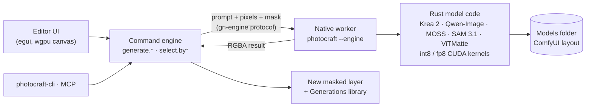

- **Everything is a command.** `generate.fill`, `generate.image`, `generate.edit`,
  `generate.expand`, `generate.splitLayers`, `generate.clownPass`, `select.byText` and the rest
  have parameter docs, tests and undo, like every other command in the editor.
- **Non-destructive.** A result lands on a new layer with a mask cut from the selection, and the
  prompt, seed and model are recorded so it can be reproduced or varied.
- **Never block, never crash.** Generation runs as a background job with progress and cancel. A
  missing model or a stopped worker is a sentence in the app, not a crash.
- **One process for the models.** The worker owns loading and residency, so the editor stays
  responsive and a model's memory is freed when you ask.

Start with [`docs/comfy/README.md`](docs/comfy/README.md) for the fork's documentation and
[`docs/comfy/architecture.md`](docs/comfy/architecture.md) for the design.

## 🖌️ The editor underneath

Everything [PhotoCraft](https://github.com/storytold/photocraft) does is still here: layers, masks,
adjustment layers, layer styles, live type, vectors, brushes, filters, real PSD and PSB files, and
a GPU compositor on wgpu.

<p align="center">
  
</p>

<details>
<summary><b>🖼️ More of the editor</b>: masks, layer styles, adjustment layers, filters</summary>

<p align="center">
  
</p>

**Masks and selections**, which the generative tools build on.

<p align="center">
  
</p>

**Layer styles and type**, saved to real PSD files.

<p align="center">
  
</p>

**Adjustment layers**, all non-destructive.

<p align="center">
  
</p>

**Filters** with live previews.

</details>

<details>
<summary><b>🧰 All 68 tools</b></summary>

Move · Artboard · Rectangular and Elliptical Marquee · Single Row Marquee · Single Column Marquee · Lasso · Polygonal Lasso · Magnetic Lasso · Object Selection · Quick Selection · Magic Wand · Crop · Perspective Crop · Slice · Slice Select · Frame · Eyedropper · Color Sampler · Ruler · Note · Count · Remove · Spot Healing Brush · Healing Brush · Patch · Content-Aware Move · Red Eye · Brush · Pencil · Mixer Brush · Color Replacement · Clone Stamp · Pattern Stamp · History Brush · Art History Brush · Eraser · Background Eraser · Magic Eraser · Gradient · Paint Bucket · Blur · Sharpen · Smudge · Dodge · Burn · Sponge · Pen · Freeform Pen · Curvature Pen · Add Anchor Point · Delete Anchor Point · Convert Point · Horizontal and Vertical Type · Horizontal and Vertical Type Mask · Path Selection · Direct Selection · Rectangle · Ellipse · Triangle · Polygon · Line · Custom Shape · Hand · Rotate View · Zoom

</details>

The full feature list, file formats and platform notes are in upstream's
[README](https://github.com/storytold/photocraft#readme).

## ❓ FAQ

<details>
<summary><b>Does anything go to the cloud?</b></summary>

No. The models run in a worker process on your own GPU, read from your own folder. There is no
account, no telemetry for generations and no credit counter.

</details>

<details>
<summary><b>Do I need ComfyUI or Python?</b></summary>

No. The engine is native Rust with its own CUDA kernels. It only borrows ComfyUI's folder layout,
so if you already have a ComfyUI `models` folder you can point the app at it and reuse the files.

</details>

<details>
<summary><b>My card has 12 or 16 GB. Will it work?</b></summary>

Yes, with the low-VRAM set: MOSS Turbo for pictures, MOSS Edit Turbo for edits and SAM 3.1 for
selection, which peak at about 12 GiB. The larger models stay selectable; they may not fit.

</details>

<details>
<summary><b>Can I use my own models and LoRAs?</b></summary>

Yes. Every model is bring-your-own, and every route accepts LoRAs from your `loras` folder. The
app never locks a model behind a licence switch; you are responsible for each model's own licence.

</details>

<details>
<summary><b>Is it a Photoshop replacement?</b></summary>

It is an alpha. The editor underneath is a mature clean-room reimplementation with real PSD
support, and the generative tools are in daily use, but expect rough edges and report them in
[Issues](https://github.com/CodyChuGit/ShotoPhopEX/issues).

</details>

## 🤝 Contributing

Issues and pull requests are welcome on
[CodyChuGit/ShotoPhopEX](https://github.com/CodyChuGit/ShotoPhopEX). New contributors and agents: start with [`AGENTS.md`](AGENTS.md), then
[`docs/`](docs/) and [`docs/comfy/`](docs/comfy/). If ShotoPhopEX saves you a subscription, a ⭐
helps other people find it.

## 🙏 Credits

- **[ArtCraft](https://github.com/storytold/photocraft) and the PhotoCraft contributors**, full credit.
  The whole editor is theirs: ShotoPhopEX is a branch of PhotoCraft that pulls in every upstream
  release as it ships, so their fixes and features land here too. The generative layer is the only
  part this fork adds.
- **The model teams**, full credit for the weights everything runs on: the **Stable Diffusion**
  community, whose open ecosystem (and ComfyUI's folder layout) this all grows from; **Krea** for
  Krea 2; the **Qwen** team at Alibaba for Qwen-Image, Qwen-Image-Edit and Qwen3-VL; the **MOSS**
  team (OpenMOSS) for MOSS-Image, plus lodestones for Kromoss; Meta for SAM 3.1, hustvl for
  ViTMatte, and every LoRA author listed in [Models](#-models).
- **The Civitai community**, for their kindness and generosity: the workflows, LoRAs and know-how
  shared there (AusBoss's outpaint, restore and inpaint work among them) shaped many of these tools.
- **Our lord and savior Jensen Huang**, for CUDA. 🙏

## License

ShotoPhopEX is dual-licensed under [MIT](LICENSE-MIT) or [Apache-2.0](LICENSE-APACHE), at your
option, like upstream. Copyright (c) 2026 ArtCraft Team and the PhotoCraft contributors, and the
ShotoPhopEX contributors. Required notices are in [NOTICE](NOTICE); bundled fonts, icons and
images keep their own licences, listed in [ATTRIBUTION.md](ATTRIBUTION.md).

Built on [PhotoCraft](https://github.com/storytold/photocraft) by the ArtCraft team. This fork is
not made or endorsed by them, and per [`docs/brand/LICENSE-brand.txt`](docs/brand/LICENSE-brand.txt)
it does not use the ArtCraft name or logos as its own. Thanks to the authors of every open model
and LoRA listed in [Models](#-models).

Model weights are not part of this repository and keep their own licences. Every artwork shown in
the editor screenshots is in the public domain; sources are in
[`docs/images/SOURCES.md`](docs/images/SOURCES.md).

<sub>Adobe, Photoshop and Firefly are trademarks or registered trademarks of Adobe Inc. in the United States and/or other countries. ShotoPhopEX is an independent, open-source project and is not affiliated with, sponsored by or endorsed by Adobe Inc.; these names are used only to describe the workflows it is compatible with. NVIDIA, RTX and CUDA are trademarks of NVIDIA Corporation.</sub>
